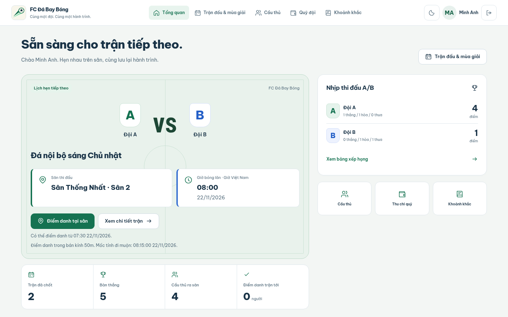
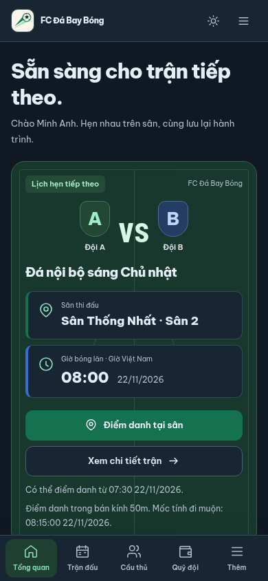
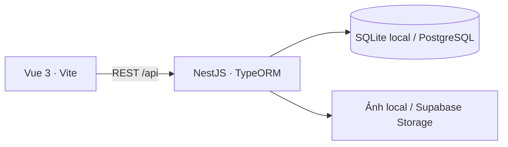

<div align="center">
  
  <h1>FC Đá Bay Bóng</h1>
  <p><strong>FCDBB · Football Club Digital Base</strong></p>
  <p>Quản lý lịch sân, điểm danh GPS, biên bản A/B, mùa giải và quỹ đội bóng phong trào.</p>
  <p>
    <a href="https://fcdbb.vercel.app/"></a>
    <a href="https://github.com/LuongNuong131/LuNu_FCDBB/actions/workflows/ci.yml"></a>
    
    
  </p>
  <p>
    <a href="#tính-năng">Tính năng</a> ·
    <a href="#chạy-local">Chạy local</a> ·
    <a href="#kiến-trúc">Kiến trúc</a> ·
    <a href="#kiểm-thử">Kiểm thử</a> ·
    <a href="#triển-khai">Triển khai</a>
  </p>
</div>

## Giao diện



*Ảnh chụp bản chạy local với dữ liệu minh họa.*

<details>
  <summary>Giao diện điện thoại · Nền tối</summary>
  <br>
  <div align="center">
    
  </div>
</details>

## Tính năng

| Khu vực | Thành viên có thể làm gì |
| --- | --- |
| **Trang chủ và lịch đá** | Xem sân, mở bản đồ, xem giờ bóng lăn theo giờ Việt Nam. Tìm trận đã qua theo tên trận, tên sân, mùa giải hoặc trạng thái. |
| **Điểm danh GPS** | Điểm danh tại sân trong bán kính 50 m. Hệ thống ghi thời gian, khoảng cách và trạng thái đúng giờ hoặc đi muộn. |
| **Đội hình và biên bản A/B** | Xem đội hình từng trận, tỉ số, bàn thắng, kiến tạo, phản lưới, MVP và ghi chú. Quản trị viên có thể xếp cầu thủ sang đội khác riêng cho trận đó. |
| **Mùa giải và thống kê** | Xem bảng xếp hạng, phong độ và thống kê cầu thủ. Xuất biên bản hoặc thống kê mùa giải sang CSV. |
| **Cầu thủ và quỹ đội** | Xem hồ sơ, vị trí, đội cố định và ảnh đại diện. Tra cứu thu chi và ảnh minh chứng. |
| **Khoảnh khắc** | Đọc bài viết nội bộ và xem album toàn màn hình. Quản trị viên có thể đăng tối đa 12 ảnh mỗi bài, đổi thứ tự và chọn ảnh bìa. |

Giao diện có nền sáng và tối, ghi nhớ lựa chọn trên trình duyệt và có thanh điều hướng riêng cho điện thoại.

### Một buổi đá diễn ra thế nào?

Quản trị viên chọn giờ bắt đầu trong **Quản trị → Lịch trận**. Với trận bắt đầu lúc **08:00**, hệ thống tự tính các mốc dưới đây theo giờ Việt Nam.

| Giờ | Hoạt động |
| :---: | --- |
| **07:30** | Mở điểm danh, sớm 30 phút. Trang chủ hiển thị mốc này dưới nút điểm danh. |
| **08:00** | Bóng lăn. Đây là giờ chính hiển thị trên trang chủ. |
| **08:15** | Mốc tính đi muộn. Điểm danh sau giờ này được ghi nhận đi muộn. |
| **10:00** | Kết thúc buổi đá, sau 2 tiếng. |

Khi lập biên bản, danh sách đội hình lấy cầu thủ đã điểm danh của trận và những người đã có trong biên bản. Quản trị viên có thể bổ sung cầu thủ qua **Thêm cầu thủ**, điều chỉnh đội A/B và chốt kết quả. Kết quả đã chốt được tính vào bảng xếp hạng khi trận thuộc mùa giải. [Hướng dẫn quản lý trận đấu và mùa giải](docs/club-management.md)

## Chạy local

Dùng **Node.js 24 LTS**, npm và Git. Backend tự tạo SQLite ở `fcdbb-backend/data/fcdbb.sqlite` khi `DATABASE_URL` để trống. [Workflow kiểm thử](.github/workflows/ci.yml)

```bash
git clone https://github.com/LuongNuong131/LuNu_FCDBB.git
cd LuNu_FCDBB
```

Mở hai terminal tại thư mục gốc của repo.

**Terminal 1 · Backend**

```bash
cp fcdbb-backend/.env.example fcdbb-backend/.env
npm --prefix fcdbb-backend ci
npm --prefix fcdbb-backend run start:dev
```

**Terminal 2 · Frontend**

```bash
cp fcdbb-frontend/.env.example fcdbb-frontend/.env
npm --prefix fcdbb-frontend ci
npm --prefix fcdbb-frontend run dev
```

Mở frontend ở `http://localhost:5173`. Khi khởi động với SQLite mới, backend tạo tài khoản quản trị local `admin` / `admin123`.

```bash
curl -fsS http://localhost:3000/api/ping
```

API phản hồi JSON có `"status": "awake"` và thời gian máy chủ.

### Cấu hình môi trường

| Ứng dụng | Biến | Cách dùng |
| --- | --- | --- |
| Frontend | `VITE_API_URL` | Địa chỉ backend có hậu tố `/api`. Mặc định là `http://localhost:3000/api`. |
| Backend | `PORT` | Cổng HTTP. Mặc định là `3000`. |
| Backend | `JWT_SECRET` | Khóa ký JWT. Đặt giá trị riêng cho production. |
| Backend | `CORS_ORIGINS` | Danh sách origin của frontend, phân tách bằng dấu phẩy. Mẫu local dùng `http://localhost:5173`. |
| Backend | `SQLITE_DB_PATH` | Đường dẫn SQLite. Mặc định là `data/fcdbb.sqlite` tính từ thư mục backend. |
| Backend | `DATABASE_URL` | Chuỗi kết nối PostgreSQL. Bỏ trống để dùng SQLite. |
| Backend | `TYPEORM_SYNCHRONIZE` | Tùy chọn đồng bộ trực tiếp schema PostgreSQL. Dùng `false` ở production. |
| Backend | `SUPABASE_URL` và `SUPABASE_KEY` | Khi cùng được cấu hình, backend lưu ảnh vào bucket `uploads` của Supabase. Ảnh local nằm trong `fcdbb-backend/public/uploads/`. |

[Biến môi trường mẫu của frontend](fcdbb-frontend/.env.example) · [Biến môi trường mẫu của backend](fcdbb-backend/.env.example)

## Kiến trúc



Frontend dùng Vue Router, Axios và Tailwind CSS. Backend dùng TypeScript, NestJS 11 và TypeORM. JWT xác thực phiên đăng nhập, bcrypt băm mật khẩu. Backend kiểm tra quyền quản trị và quyền cập nhật hồ sơ, đồng thời lấy danh tính điểm danh từ token.

```text
LuNu_FCDBB/
├── fcdbb-frontend/       # Vue, các trang nghiệp vụ và kiểm thử Playwright
│   ├── src/
│   └── public/           # Logo Bóng bứt tốc và favicon
├── fcdbb-backend/        # NestJS, TypeORM và kiểm thử Jest
│   ├── src/fcdbb/        # Tài khoản, lịch, điểm danh, quỹ và blog
│   ├── src/football/     # Mùa giải, biên bản, thống kê và nhật ký
│   └── src/migrations/   # Migration PostgreSQL
├── docs/                # Hướng dẫn nghiệp vụ, thiết kế và ảnh minh họa
└── .github/workflows/   # Build và kiểm thử tự động
```

### API thường dùng

Các route dưới đây có prefix `/api`. Chỉ `/ping` và `/auth/login` mở công khai. Các route nội bộ cần header `Authorization: Bearer <token>`.

| Method | Endpoint | Chức năng | Quyền |
| --- | --- | --- | --- |
| `GET` | `/ping` | Kiểm tra API | Công khai |
| `POST` | `/auth/login` | Đăng nhập và nhận JWT | Công khai |
| `GET` | `/home` | Trận tiếp theo và lịch sử gần nhất | Thành viên |
| `GET` / `POST` | `/matches` | Xem danh sách hoặc tạo lịch | Thành viên / Admin tạo |
| `PUT` | `/matches/:id` | Sửa lịch đấu | Admin |
| `POST` | `/attendance/checkin` | Điểm danh với `matchId`, `lat`, `lng` | Thành viên |
| `GET` / `PUT` | `/matches/:id/report` | Xem hoặc lưu biên bản | Thành viên / Admin lưu |
| `GET` | `/matches/:id/audit` | Xem nhật ký thay đổi | Admin |
| `GET` | `/competition/matches` | Tìm, lọc và phân trang trận đấu | Thành viên |
| `GET` | `/competition/summary` | Bảng xếp hạng và thống kê cầu thủ | Thành viên |
| `GET` | `/users`, `/funds`, `/blog` | Danh sách cầu thủ, sổ quỹ và bài viết | Thành viên |

Avatar dùng multipart field `file`. Album blog dùng `images` cùng các trường quản lý ảnh giữ lại, thứ tự và phiên bản khi sửa. [API mùa giải, quản trị và schema](docs/club-management.md#api-mới)

## Kiểm thử

Sau khi cài dependencies ở cả hai ứng dụng, chạy các lệnh từ thư mục gốc.

```bash
npm --prefix fcdbb-backend run build
npm --prefix fcdbb-backend test -- --runInBand
npm --prefix fcdbb-backend run test:e2e -- --runInBand
```

```bash
cd fcdbb-frontend
npm run build
npx playwright install chromium
npm test
```

Playwright tự chạy backend cổng `3001` và frontend cổng `5174` với SQLite tạm. Bộ kiểm thử kiểm tra các luồng chính, khả năng truy cập bằng axe và bố cục trên nhiều kích thước màn hình. [Kết quả GitHub Actions](https://github.com/LuongNuong131/LuNu_FCDBB/actions/workflows/ci.yml)

## Triển khai

Production lấy mã từ nhánh `master`. Frontend chạy trên **Vercel**, backend trên **Render**. [Website production](https://fcdbb.vercel.app/) · [Trạng thái API](https://fcdbb-be.onrender.com/api/ping)

| Thiết lập | Vercel · Frontend | Render · Backend |
| --- | --- | --- |
| Thư mục gốc | `fcdbb-frontend` | `fcdbb-backend` |
| Lệnh build | `npm run build` | `npm install && npm run build` |
| Đầu ra hoặc lệnh chạy | `dist` | `npm run start:prod` |
| Kết nối | `VITE_API_URL` trỏ tới backend với hậu tố `/api` | `CORS_ORIGINS` trỏ tới origin frontend. Dùng `DATABASE_URL` với PostgreSQL. |

Vercel dùng rewrite cho các route Vue khi tải lại. Backend chạy migration PostgreSQL khi khởi động. Khi triển khai môi trường mới, dùng mật khẩu quản trị và `JWT_SECRET` riêng, quản lý khóa qua biến môi trường của host. [Cấu hình route Vercel](fcdbb-frontend/vercel.json) · [Migration và cấu hình production](docs/club-management.md#schema-và-triển-khai)

<details>
  <summary>Xử lý lỗi khi chạy local</summary>

| Hiện tượng | Cách kiểm tra |
| --- | --- |
| Frontend báo lỗi mạng | Gọi `/api/ping`, kiểm tra `VITE_API_URL` và origin trong `CORS_ORIGINS`. |
| Cổng `3000` hoặc `5173` đang bận | Đổi cổng ứng dụng và cập nhật địa chỉ liên quan trong file `.env`. |
| Không đăng nhập được bằng tài khoản mẫu | Kiểm tra đường dẫn SQLite. Tài khoản mẫu được tạo khi database chưa có user `admin`. |
| Ảnh không hiển thị | Kiểm tra URL ảnh, thư mục `public/uploads` hoặc cấu hình Supabase. |
| Tải lại route trên hosting trả 404 | Kiểm tra rewrite về `index.html` cho các route của Vue Router. |

</details>

## Tài liệu và đóng góp

- Quy trình lập biên bản, đội hình A/B, audit và các endpoint quản trị. [Hướng dẫn nghiệp vụ](docs/club-management.md)
- Màu sắc, kiểu chữ, bố cục và hành vi trên điện thoại. [Design system](docs/design-system.md)
- Logo **Bóng bứt tốc** dùng cho đội và website. [SVG](fcdbb-frontend/public/fcdbb-logo.svg) · [PNG nền trong](fcdbb-frontend/public/fcdbb-logo.png) · [Favicon](fcdbb-frontend/public/favicon.ico)

Khi gửi đóng góp, mô tả thay đổi, đính kèm ảnh nếu sửa giao diện và chạy các kiểm thử liên quan. Giữ `.env`, database local và ảnh tải lên ở ngoài commit.

Repo hiện chưa có tệp `LICENSE`.
